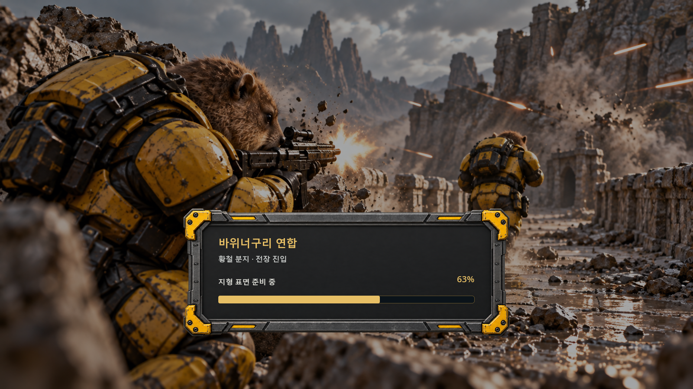
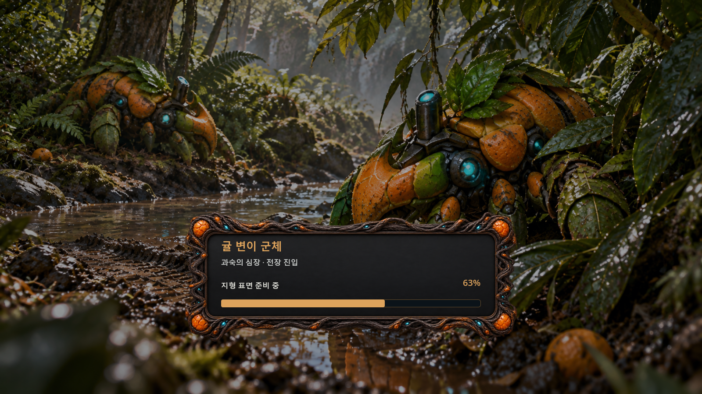
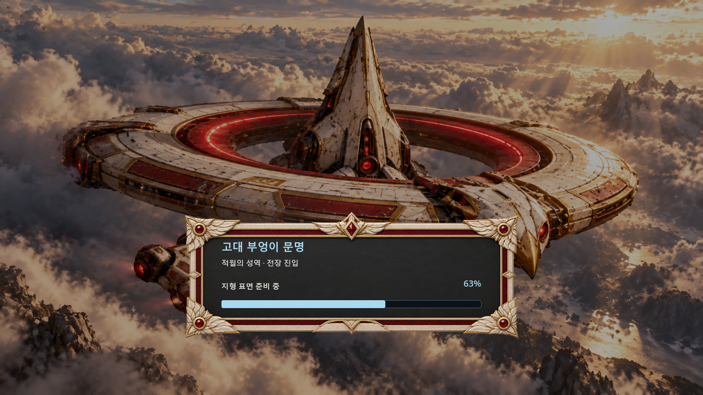

# 2026-10-24 이동·전투·로딩 개선판

원본 맵의 실제 이동 판정을 복원하고 유닛의 경로 계산을 이에 맞췄습니다. 움직이는 목표를 따라가기만 하던 근접 공격, 명령창 배치, 건설·아이콘·방향 표시, 세 종족의 밸런스와 플레이어 색상 선택을 함께 수정했습니다. 세 종족별 스토리 중심 로딩 원화10장씩 총30장은 사용자 최종 승인 후 반영했습니다.

## 게임 변경

- 세 맵의 원본 8픽셀 이동 판정과 오래된 이동 여유 공간 캐시를 다시 연결했습니다. 지상 경로는 유닛 몸체 전체의 통과 여부를 검사하며, 실제 차단 지형·절벽·물은 보존합니다. 작은 원본 차단 바위도 화면에 보이게 표시합니다.
- 근접 공격은 목표의 짧은 이동을 예측해 접근하고 공격을 시작하면 짧게 동작을 유지합니다. 이동속도·공격 사거리 증가나 순간이동으로 문제를 가리지 않았습니다.
- 42개 확장 자원 지대의 본부 건설 간격을 확인하고 광물 최소 간격을 2타일로 조정했습니다. 자원 위치는 바꾸지 않았습니다.
- 스킬은 명령창 아래 왼쪽, 각종 취소는 아래 오른쪽에 배치합니다. 대기·변태 배양체 혼합 선택에는 생산을 표시하고, 전부 변태 중이면 취소만 표시합니다.
- 건설 완료 원화는 100%에 도달한 후 표시합니다. 귤의 커진 일귤 초기 단계는 생략합니다. 공격받지 않은 건설 건물의 피해 불꽃·피 표현을 막고 건설 시작·진행·완료 소리의 음량과 재생 우선순위를 높였습니다.
- 테라 촉매의 바위는 건물 아래의 원래 지형 레이어를 유지합니다. 공사 중 남아 있다가 마지막 12%에서 부드럽게 융화합니다. 지형을 건물 앞으로 올리던 임시 처리는 사용자 지적으로 제거했습니다.
- 방향에 따른 일부 유닛 크기·보는 방향·채취 방향, 제자리 날갯짓, 확대 중 유닛 그림 갱신, 귤 HUD 상단과 미니맵 오른쪽 경계, 불꽃 색을 보정했습니다. 기존 초상화와 원본 원화는 보존합니다.
- 명령·유닛·건물·지원 스킬 아이콘 195개를 독립된 이미지로 분리하고 이웃 셀에서 넘어온 점과 가는 조각을 제거했습니다. 기존 페이지 화살표도 확인했습니다.
- 세 종족의 유닛 비용·체력·실드·공격 주기·사거리를 비교해 보수적으로 조정하고 전 39개 건물 중 22개의 내구도를 조정했습니다. 이는 첫 밸런스 조정이며 최종 경쟁 밸런스를 보장하는 수치는 아닙니다. 자세한 값은 `balance-adjustments-20261024.json`, `building-balance-20261024.json`, `counter-bonus-changes-20261024.json`에 기록했습니다.
- 원본 스프라이트의 종족색 부분만 화면에서 바꾸는 8가지 플레이어 색상을 추가했습니다. 같은 종족도 구분하며 중복 선택을 방지합니다. 초상화·HUD·지형·별도 피해 효과는 색 변경 대상에서 제외합니다.
- 싱글·멀티 시작 시 실제 맵·이동·그리기 준비 진행률을 보여주는 종족별 로딩창을 추가했습니다. 글씨·로딩바·항복창 내용은 원화 테두리 안쪽에 배치합니다.
- 저지대 지상 시야는 높은 지형을 평소 볼 수 없습니다. 높은 곳에서 실제 공격받으면 발사 지점 주변 반경 2만 1.5초간 노출되고 이후 다시 가려집니다. 공중 정찰·고지대 진입·기존 스캔은 정상 시야를 제공합니다.
- 성좌추격기는 같은 대상에 지속 광선을 유지하며 피해를 시간에 따라 계산합니다. 장갑·강화·집중 피해를 유지하고 대상 변경이나 사거리·시야 이탈 시 집중이 초기화됩니다. 대심판선의 표시 크기를 키웠습니다.

## 검증 범위

| 확인 | 결과 |
| --- | --- |
| 원본 이동 마스크와 48개 유닛 이동 캐시 대조 | 12,582,912칸 일치 |
| 원본 상세 지형·경사로 | 787,802개 검사와 실제 경사로 이동 44건 통과 |
| 세 맵의 정비공·보병 장거리 이동 | 24개 실제 이동 완료, 96개 검사 통과 |
| 움직임·방향 전환 목표에 대한 근접 공격 | 8개 검사 통과, 16초당 50~69회 타격 재현 |
| 고지대 시야·공중 정찰·성좌추격기 지속 광선 | 37개 검사 통과 |
| 아이콘 독립 여백·실제 명령창 참조 | 416개 검사 통과 |
| 새 로딩창·항복창 여백·건설 소리 | 39개 검사 통과 |
| 실제 비동기 로딩·첫 화면 캐시 재사용·멀티 준비 대기 | 4,350개 검사 통과 |
| 확대 중 유닛 갱신·채취 방향·건설 피해 효과 | 77개 검사 통과 |
| 촉매 원래 지형 레이어·건설 4시점 | 세 종족 실제 화면 12개와 판정 검사 통과 |
| 종족별 승인 로딩 원화와 무작위 선택 | 30장 디코딩·세 종족 전체 선택·연속 중복 방지, 750개 검사 통과 |
| 새 Windows 실행파일 | 실제 로컬 게임 시작·패키지 안 원화30장 모두 읽기 통과 |
| 실행파일 게임 아이콘 | 원본 ICO와16/24/32/48/64/128/256px의7개 해상도 픽셀 일치 |
| 다운로드 ZIP | 필수5개 파일·전체 CRC·SHA-256 확인, 1,308,911,571바이트 |
| 공개 접속 서비스와 네이티브 WebRTC | 같은 PC의 플레이어 2명·관전자 1명 연결 및 승패 동기화 통과 |

공개 접속 검사는 같은 PC에서 공개 HTTPS 서비스를 경유한 범위입니다. 서로 다른 외부 회선의 PC 간 연결을 검증한 결과는 아닙니다. 게임의 모든 장면·모든 프레임을 수동 검수한 것으로 보고하지 않습니다.

## 로딩 원화와 실제 화면

승인 기록은 [loading-art-approval-20261024.json](loading-art-approval-20261024.json), 최종 원화 해시·등장 유닛·제작 지시는 [loading-art-final-review-20261024.json](loading-art-final-review-20261024.json)에 기록했습니다. 승인되지 않거나 원본 외형과 다른 이전 시안은 게임에 등록하지 않았습니다.

항복창·촉매 레이어·검사 결과 파일도 [검증 자료 폴더](verification_feedback2_20261024)에 있습니다. 새 다운로드는 `feedback2-20261024` 릴리스로 제공하며 이전 `feedback-20261024` 릴리스는 보존합니다.
