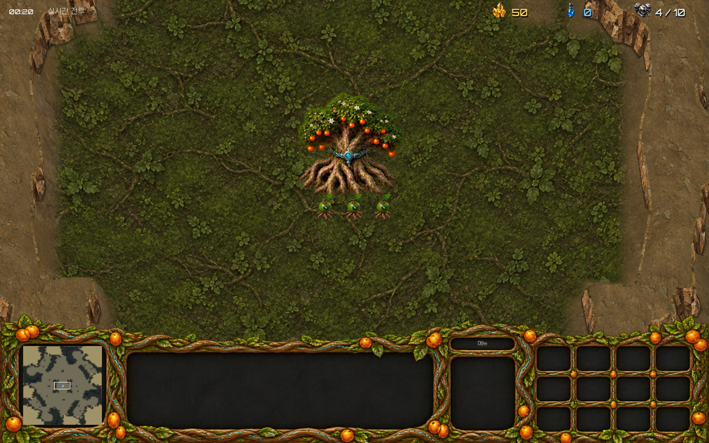
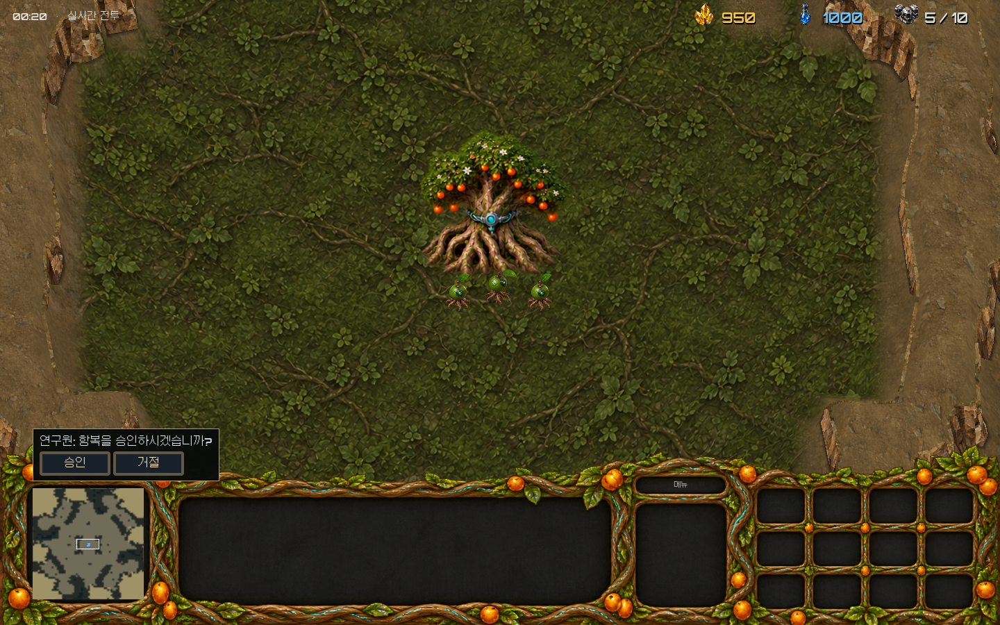
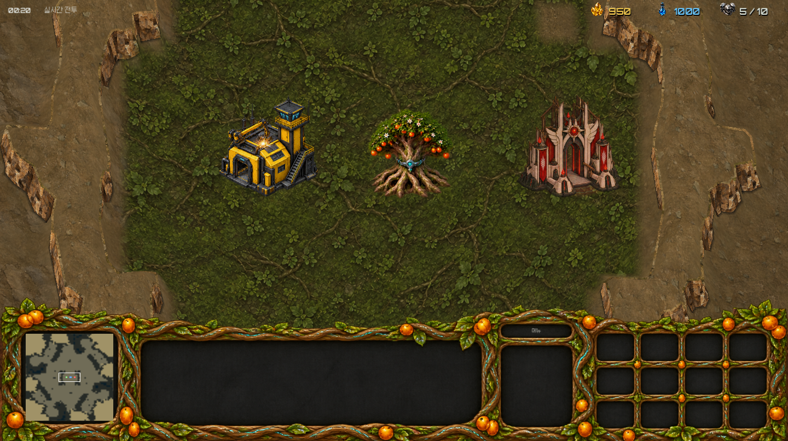
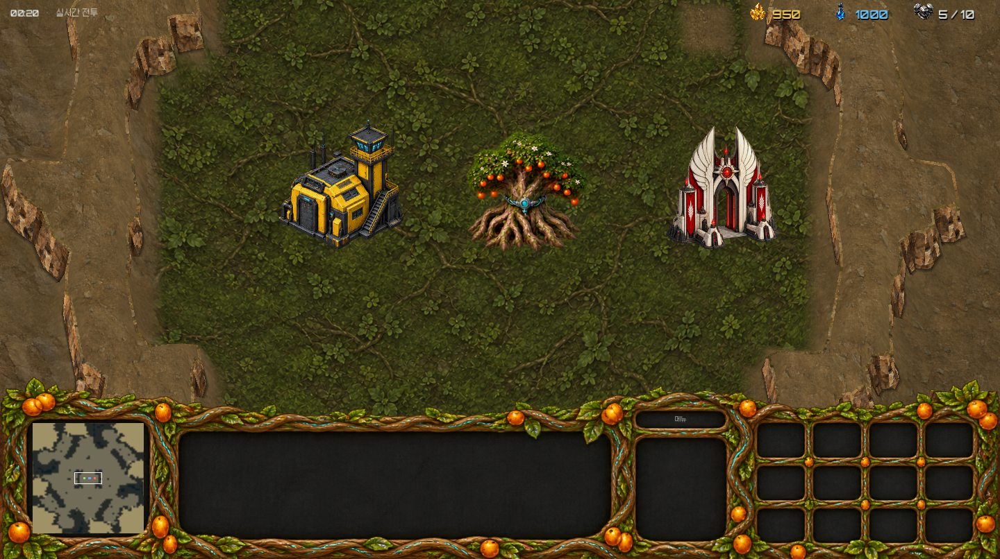

# 2026-10-24 화면·동작 수정판

전 종족 39개 건물은 건설 중 앞의 4단계만 표시한다. 진행도 100%에서 마지막 5단계 완성 원화를 처음 표시하고, 이후 생산·연구 중에도 같은 몸체를 유지한다. 부엉이의 미완성 원화에는 대의회전당의 기존 소환진과 붉은 물질화 표현을 공통 적용했다. 종족별 건설·완성 효과음 6개를 추가했으며 작업이 멈추면 건설음도 반복하지 않는다.

23종을 빠르게 대조한 뒤 발견한 방향·걷기·부품 문제를 부분 수정했다. 돌격병 NE와 축조자 W 걷기, 덩굴포식자 N의 검은 기계장치, 씨앗포식자 이동 중 불꽃, 접목파쇄자 왼쪽 방향, 부엉이 궁수의 중복 몸체, 사제·심판관의 중복 지팡이와 장비 누락, 어둠날개의 왼쪽 방향, 성좌보행기의 포구와 뒤쪽 공격을 보정했다. 가시꽃은 대기·이동·공격 240개 프레임의 주황색 몸통을 기준으로 배율을 맞췄다. 원본 파일은 보존하고 수정 연결표로 교체한다.

유닛과 건물 그림자는 지면의 연한 원형 하나로 통일했다. 사망체·잔류 자국은 살아 있는 유닛 아래에 표시한다. 항공기와 부유 기계는 고정 방향 몸체를 유지하고 기존 추진구의 효과만 별도로 표시한다. 굴착포 전차의 고정 지지대 전개를 복구했다. 생산 중 건물의 전체 이미지 교체·문 개폐를 없애고 기존 발광 부분의 작은 깜박임만 표시한다. 귤 건물 피해는 기존 굵은 주황 선 대신 새 투명 액체 원화를 사용한다.

기존 초상화와 아이콘 원본을 유지한다. 정찰드론 아이콘만 현재 두 회전자 외형에 맞췄고 페이지 화살표의 이웃 그림 조각을 제외했다. 귤 HUD 상단은 생성 결과의 잎 끝 연장 부분만 원본 위에 붙여 복원했다. 기존 패널·열매·버튼 그림과 화면 좌표는 유지했다. 귤 바닥은 조용한 녹색 바탕으로 바꿔 갈색 지면과 구분했다. 휠 확대는 부드럽게 보간하며 창 크기를 늘릴 때 카메라 경계를 다시 계산한다.

요격드론은 체력만 45→70으로 올렸다. 강철둥지모함 여러 대를 선택해 생산하면 각 모함에 한 기씩 예약되고 해당 모함에서 나온다. 전 종족의 경장갑·중장갑 추가 피해 24개 수치는 절반으로 줄이고 정수 올림했으며 기존 +1은 유지했다. 나머지 기본 공격력·공격 주기·방어력·이동 속도는 바꾸지 않았다. [수치 변경표](counter-bonus-changes-20261024.json)

근접 유닛은 움직이는 목표의 현재 접촉 지점을 따라가며 도달한 처리 주기 안에 타격한다. 그 순간 걷기 표시가 공격 동작을 덮지 않게 했다. 배양 중인 배양체에는 취소 버튼만 표시하며 취소하면 비용과 공급 예약은 반환하고 해당 배양체는 사망한다. 적 건물을 모두 파괴하면 남은 적 유닛과 관계없이 승리한다.

컴퓨터는 경기 시작 3분 이후 큰 전력 열세가 20초 유지되면 미니맵 위에 항복 승인 요청을 표시한다. 승인하면 해당 컴퓨터가 패배하고, 거절하면 계속 싸운다. 거절 후 2분 동안 다시 요청하지 않는다. 다른 플레이어는 요청을 대신 승인할 수 없다.

## 원본 맵 대조

원본에서 추출한 CHK/CV5/VF4 이동 격자와 투혼·파이썬·로스트템플을 대조했다. 평지를 임의로 열던 보정을 제거했으며 세 맵의 8픽셀 단위 786,432칸과 실제 지형 이동 판정이 모두 일치했다. 이는 추출된 원본의 정적 지형 연결에 대한 확인이다. 건물·자원과 우리 유닛의 몸체 크기에 따른 충돌은 별도로 적용된다. 지형 그림 자체가 원본 게임과 동일하다는 뜻은 아니다. [대조 결과](verification_feedback_20261024/gameplay.json)

## 확인 및 실행파일

| 확인 | 결과 |
|---|---|
| 원본 초상화·고정 몸체·이동·그림자·미니맵·확대 | 199개 통과 |
| 39개 건물의 건설 4단계와 100% 완성 원화 | 898개 통과 |
| 원본 맵·건설음·근접 추격·배양 취소·승리·항복 | 42개 통과 |
| 여러 모함의 개별 생산·소환·체력 | 12개 통과 |
| 실제 화면의 HUD·바닥·취소·항복·창 크기 변경 | 11개 통과 |
| 기존 배양체 동작 확인 | 66개 통과 |
| 새 Windows 실행파일에서 컴퓨터전 시작 | 정상 종료, 오류 없음 |

23종 원화는 빠른 방향·동작 대조 범위다. 모든 애니메이션 프레임을 하나씩 수동 승인한 전수 검수로 처리하지 않았다. 수정 후 원화 연결과 실제 렌더링을 확인했으며 기존 미검수 표기는 임의로 승인 상태로 바꾸지 않았다.

새 빌드의 EXE에 기존 game_icon.ico의 16·24·32·48·64·128·256픽셀 그림을 삽입하고 원본 ICO 바이트와 대조했다. 이후 빌드에서도 누락되지 않도록 내보내기 절차에 삽입·확인을 포함했다. 기존 배포 태그와 압축파일은 유지하고 새 배포로 제공한다.

## 실제 화면

이미지 생성 기록: [부분 수정 프롬프트](visual-feedback-image-prompts-20261024.json), [바닥·HUD 복원 프롬프트](hud-ground-prompts-20261024.json). 사용 스킬: imagegen (`C:/Users/Admin/.codex/skills/.system/imagegen/SKILL.md`).
