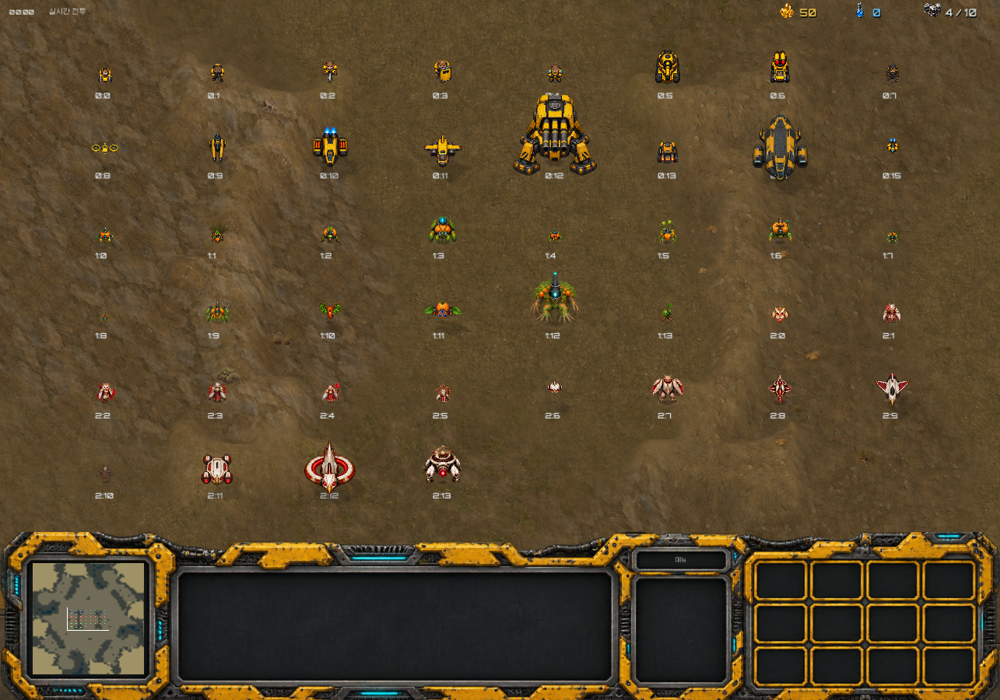
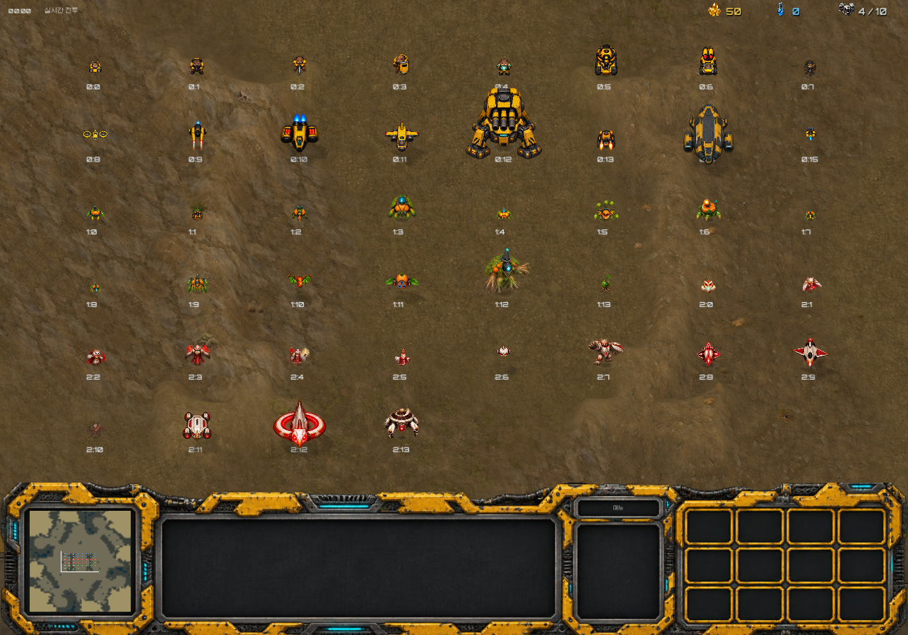
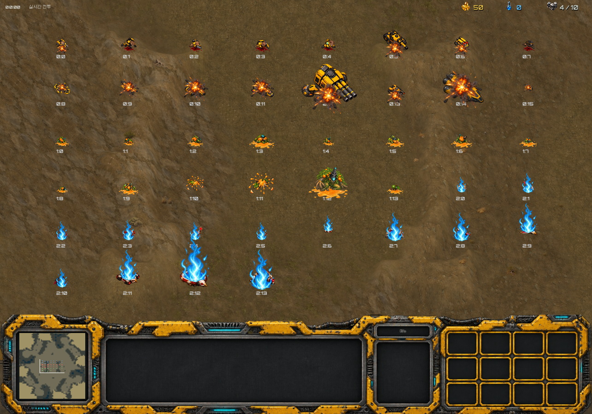

# Sprite connection preview — 2026-10-24

All 44 unit replacements are connected. The missing 42 owl attack poses were added. The 21 previously reviewed definitions remain preserved; the remaining 23 units have not received a full direction, anatomy or animation review.

Quick check: 139 checks passed, 0 failed. The normal catalog loaded all 44 units, sampled action textures and cell bounds were present, and all 44 units rendered on screen for idle, movement and attack. Native overview screenshots for these actions and the faction death effects were inspected for obvious missing art and severe clipping. This is not a full animation or gameplay test.

The exported Windows executable reached its main scene in a headless startup run and exited with code 0. No script/resource errors were logged. Godot reported an ObjectDB cleanup warning at the forced test exit; this is not classified as a startup failure. Networking, long matches and full visual QA were not exercised.

Download the Windows ZIP from the `sprites-20261024` GitHub prerelease, extract the whole folder, and run `AsteraCraft.exe`. Keep the PCK and WebRTC DLL alongside the executable. Earlier releases remain unchanged.

## Native overview captures

